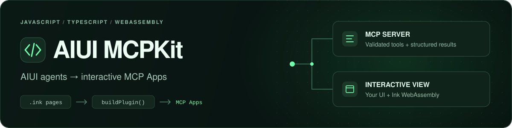
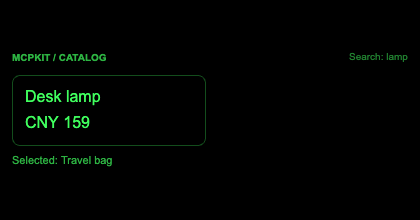

<p align="center">
  <picture>
    <source media="(max-width: 600px)" srcset="docs/assets/readme-banner-compact.svg">
    
  </picture>
</p>

<h3 align="center">Give your AI tools an interface.</h3>

<p align="center">
  Build interactive MCP Apps with JavaScript and AIUI.<br>
  Ship your pages, Ink WebAssembly renderer and MCP server as one plugin.
</p>

<p align="center">
  <a href="https://github.com/yodaos-project/aiui-mcpkit/actions/workflows/ci.yml"></a>
  <a href="https://github.com/yodaos-project/aiui-mcpkit/actions/workflows/benchmark.yml"></a>
  <a href="package.json"></a>
</p>

<p align="center">
  <strong>English</strong> · <a href="README.zh-CN.md">简体中文</a><br>
  <a href="#quickstart">Quickstart</a> · <a href="#build-your-own">Build your own</a> · <a href="docs/README.md">Documentation</a> · <a href="#contributing">Contributing</a>
</p>

## Tools people can use

Let the assistant return structured data while the user works with buttons, forms and live state. Build order calculators, product selectors and shared workspaces that connect UI actions to the conversation.

<table>
  <tr>
    <th width="50%" align="left">Travel Planner · Fieldnotes</th>
    <th width="50%" align="left">Focus Studio</th>
  </tr>
  <tr>
    <td width="50%" align="center" valign="top"><a href="docs/assets/examples/travel.png"></a></td>
    <td width="50%" align="center" valign="top"><a href="docs/assets/examples/focus.png"></a></td>
  </tr>
  <tr>
    <td valign="top">Switch days, save a stop and explicitly share it with the assistant.</td>
    <td valign="top">Set a task and duration, then start, pause or reset the timer.</td>
  </tr>
  <tr>
    <td><a href="examples/travel">Explore Travel Planner →</a></td>
    <td><a href="examples/focus">Explore Focus Studio →</a></td>
  </tr>
</table>

<table>
  <tr>
    <th width="50%" align="left">Analytics Lab · Signal</th>
    <th width="50%" align="left">Event Booking · The Making Room</th>
  </tr>
  <tr>
    <td width="50%" align="center" valign="top"><a href="docs/assets/examples/analytics.png"></a></td>
    <td width="50%" align="center" valign="top"><a href="docs/assets/examples/events.png"></a></td>
  </tr>
  <tr>
    <td valign="top">Switch week/month to update the metrics and chart together.</td>
    <td valign="top">Choose a session and seats, review the total and confirm a local demo.</td>
  </tr>
  <tr>
    <td><a href="examples/analytics">Explore Analytics Lab →</a></td>
    <td><a href="examples/events">Explore Event Booking →</a></td>
  </tr>
</table>

<sub>Real Ink/WASM captures from the local MCP Apps browser harness. Travel, analytics, workshop and business data are demo fixtures. Workshop confirmation makes no real booking or payment; the timer runs while its View is open. Conversation sharing requires host support.</sub>

<details>
<summary><strong>Also explore business results and shared Apps</strong></summary>

<table>
  <tr>
    <th width="50%" align="left">Calculate and act</th>
    <th width="50%" align="left">Search, inspect and select</th>
  </tr>
  <tr>
    <td width="50%" align="center" valign="top"><a href="docs/assets/business.png"></a></td>
    <td width="50%" align="center" valign="top"><a href="docs/assets/shared-agent-search.png"></a></td>
  </tr>
  <tr>
    <td valign="top">Return a validated quote to the model. Let the user calculate again or cancel from the same interface.</td>
    <td valign="top">Use multiple tools in one App. Preserve search, navigation and selection within each live View.</td>
  </tr>
  <tr>
    <td><a href="docs/guides/business-tools.md">Build business tools →</a></td>
    <td><a href="docs/guides/shared-agent.md">Build a shared App →</a></td>
  </tr>
</table>

</details>

https://github.com/user-attachments/assets/487a1771-ca2d-4b04-91f4-8a55f8f8eba1

**[Watch the 33-second English showcase →](docs/assets/mcpkit-showcase.mp4)** · [Without background music](docs/assets/mcpkit-showcase-nobgm.mp4)

<details>
<summary>About the showcase and media credits</summary>

From a Codex conversation to an independent view and back, with the same selection preserved. The English film also highlights desktop agents such as Codex and Claude Code, and AIUI on Rokid Glasses. The Codex/desktop shells are labelled illustrations, app interfaces are actual runtime captures, and the glasses use the official product image from the [AIUI site](https://open.rokid.com/aiui/?lang=en-US). Interactive desktop views depend on host capabilities. Music: [Cat Walk — Arulo](https://assets.mixkit.co/music/371/371.mp3) ([Mixkit license](https://mixkit.co/license/#musicFree)); sound effects: [Mixkit](https://mixkit.co/license/#sfxFree).

</details>

## Why build with MCPKit?

- **Define pages and tools together.** Tool names and schemas live in `.ink` pages. Generate tool registration, runtime validation and TypeScript contracts from one source.
- **Connect the assistant to live state.** Expose App/Page methods with `ModelContext.defineAction()`. Send messages and publish selected context through `getApp().getAgent()`.
- **Run business logic beyond the View.** Use Ink Agent Workers or Node.js server handlers for calculations and integrations. Keep server credentials out of UI code.
- **Build, ship and verify.** `buildPlugin()` bundles the server, UI, runtime and manifests. Check readiness with [preview verification](docs/guides/preview-verification.md) and build identity with [diagnostics](docs/guides/build-diagnostics.md).

## Quickstart

Start in your browser with **Node.js 22+**, Git and a text editor. The first preview needs no AI account or API key.

Run in a terminal:

```sh
git clone https://github.com/yodaos-project/aiui-mcpkit.git
cd aiui-mcpkit
npm ci
npm run watch:examples -- counter
```

Open the URL in the terminal's `preview` line and keep the command running. Counter starts at **0**; click **+ ADD ONE** to reach **1**. Save a source edit to rebuild and reload. Press **Ctrl+C** to stop.

[Complete first-run walkthrough →](docs/getting-started/quickstart.md) · [Environment setup →](docs/getting-started/installation.md)

The preview uses real Ink/WASM and supplies launch input. It does not run an AI model or server business calls. When you are ready for an assistant, follow [client setup](docs/guides/clients.md).

## Build your own

Learn one capability at a time, with a working result at every step:

1. **[Your first edit](docs/getting-started/edit-example.md)** — Change a button and see it reload
2. **[Your first app](docs/getting-started/first-agent.md)** — Create your own two-file app
3. **[Page tools](docs/guides/page-tools.md)** — Open it with validated tool arguments
4. **[Connect a client](docs/guides/clients.md)** — Call it from an assistant
5. **[Your first business tool](docs/guides/first-business-tool.md)** — Return a calculated result to the assistant and UI

[Follow the full learning path →](docs/README.md)

Already building an integration? Use the [ESM guide](docs/guides/esm-build.md) and [Build API](docs/reference/build-api.md). The [example collection](examples/README.md) covers six plugins and their install commands.

## Client support

MCPKit generates **local stdio servers**. Interactive rendering needs an MCP Apps host with WASM support. Clients without Apps support receive tool data and an explicit UI-unavailable response.

| Surface | Verification |
| :--- | :--- |
| **Ink/WASM + MCP Apps bridge** | Real browser tests cover tool input/results, UI actions, display modes, messages, context and cancellation. |
| **Codex Desktop** | Counter inline UI has been observed; other interactions and modes are covered in the browser harness. |
| **Claude Desktop / VS Code** | Connection guides are available; this project's UI still needs verification in these clients. |
| **Conversation + live tools** | Host capabilities and View-tool routing determine availability. Actual model consumption of context needs separate verification. |

See [protocol compatibility](docs/reference/compatibility.md) and [runtime prerequisites](docs/guides/runtime-integration.md) for details. HTTPS deployment and conversation-card rendering remain separate work.

## Go deeper

| Build | Connect | Verify |
| :--- | :--- | :--- |
| [AIUI, Ink and MCPKit](docs/getting-started/overview.md) | [Client setup](docs/guides/clients.md) | [Preview verification](docs/guides/preview-verification.md) |
| [Build API](docs/reference/build-api.md) | [Agent sessions](docs/guides/agent-session.md) | [Build diagnostics](docs/guides/build-diagnostics.md) |
| [Plugin metadata](docs/guides/metadata.md) | [Runtime and Workers](docs/guides/runtime-integration.md) | [Benchmarks](docs/reference/benchmarks.md) |
| [Shared Apps](docs/guides/shared-agent.md) | [State restoration](docs/guides/state-restoration.md) | [Troubleshooting](docs/guides/troubleshooting.md) |
| [Example collection](examples/README.md) | [Development loop](docs/guides/development.md) | [Contributing](docs/contributing.md) |

[Browse all documentation →](docs/README.md)

## Contributing

Bring a runnable example, a client test report or a focused fix. [Open an issue](https://github.com/yodaos-project/aiui-mcpkit/issues) with your client version and reproduction steps, or send a pull request.

```sh
npm run build:examples
npx playwright install chromium
npm run typecheck
npm test
```

See [contributing](docs/contributing.md) for Worker test setup and benchmark checks.

---

<p align="center">
  Built on <a href="https://github.com/yodaos-project/AIUI">AIUI</a> · <a href="https://github.com/jsar-project/ink">Ink</a> · <a href="https://github.com/modelcontextprotocol/ext-apps">MCP Apps SDK</a>
</p>
