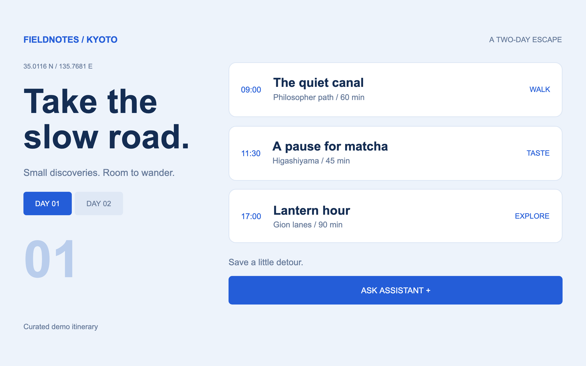
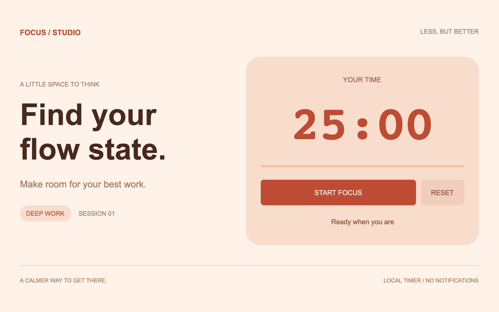
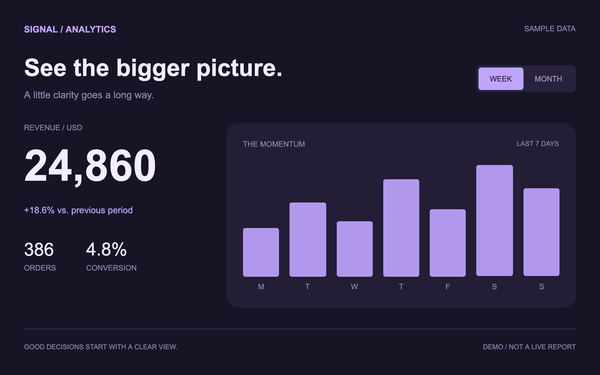
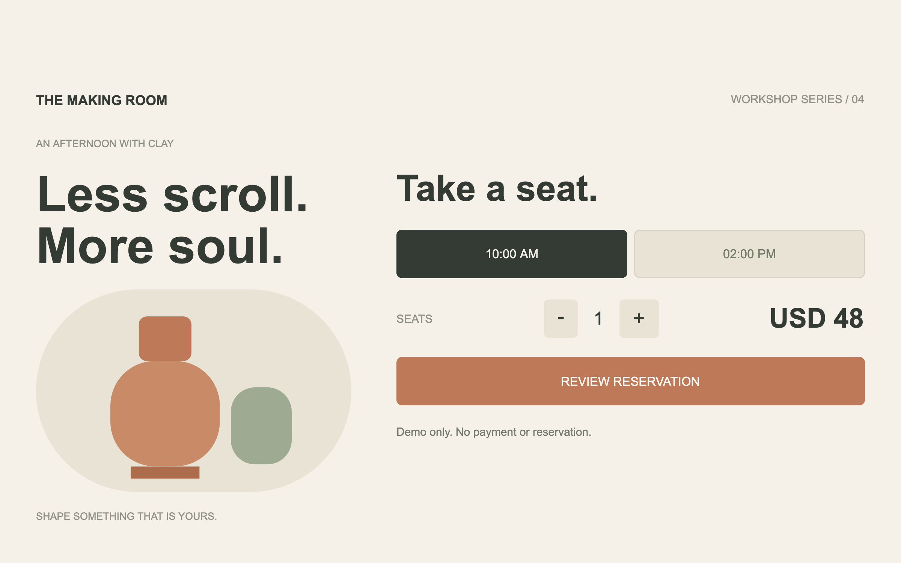

# AIUI MCPKit

**Build interactive MCP Apps with JavaScript and AIUI.**

Give your AI tools an interface people can use: buttons, forms, calculations and live state inside an MCP Apps client. MCPKit turns your [AIUI agent](https://github.com/yodaos-project/AIUI) into a plugin, bundling its pages, the [Ink](https://github.com/jsar-project/ink) WebAssembly renderer and an MCP server.

[](https://github.com/yodaos-project/aiui-mcpkit/actions/workflows/ci.yml)
[](https://github.com/yodaos-project/aiui-mcpkit/actions/workflows/benchmark.yml)
[](package.json)

[简体中文](README.zh-CN.md) · [Quickstart](#quickstart) · [Examples](#see-it-in-action) · [Documentation](docs/README.md) · [Contributing](#contributing)

## See it in action

Four new examples, each with its own visual identity and a working interaction:

| Travel Planner · Fieldnotes | Focus Studio |
| --- | --- |
| [](examples/travel) | [](examples/focus) |
| Switch days, save a stop and explicitly share it with the assistant. | Open with a task and duration, then start, pause or reset the timer. |

| Analytics Lab · Signal | Event Booking · The Making Room |
| --- | --- |
| [](examples/analytics) | [](examples/events) |
| Change the period to update both metrics and the chart. | Choose a session and seats, review the total and confirm a local demo. |

| Interactive Counter | Business tools |
| --- | --- |
| [](examples/counter) | [](examples/business) |
| Open a page with tool arguments, change state and expand the view. | Return a quote to the model, render stock data and call or cancel work from the UI. |

*Real Ink/WASM output captured in the local MCP Apps browser harness. Travel, analytics, workshop and business data are demo fixtures. Workshop confirmation makes no real booking or payment; the timer runs while its view is open. Conversation sharing requires host support.*

[](docs/assets/mcpkit-showcase.mp4)

**[Watch the 33-second English showcase →](docs/assets/mcpkit-showcase.mp4)** · [Without background music](docs/assets/mcpkit-showcase-nobgm.mp4) · [Video source and reproduction](videos/showcase/README.md)

From a Codex conversation to an independent view and back, with the same selection preserved. The English film also highlights desktop agents such as Codex and Claude Code, and AIUI on Rokid Glasses. The Codex/desktop shells are labelled illustrations, app interfaces are actual runtime captures, and the glasses use the official product image from the [AIUI site](https://open.rokid.com/aiui/?lang=en-US). Interactive desktop views depend on host capabilities.

## Why MCPKit?

- **Define the tool where you build the UI.** Page schemas generate tool registration, validated inputs and typed business contracts. Keep names, descriptions and schemas in your `.ink` pages.
- **Let the model use your live UI state.** Expose App/Page methods with `ModelContext.defineAction()` or register tools dynamically. Calls execute against the running instance, with cancellation and tool-list updates.
- **Connect UI actions to the conversation.** Send user messages, publish selected context, call host tools and read resources through `getApp().getAgent()`. Publish only the state you choose.
- **Build business tools with TypeScript.** Generated types and runtime validation cover inputs and outputs. Structured results reach the model; UI-only metadata supports rendering. Credentials stay in server code.
- **Run business logic without opening a view.** Use a manifest-declared Agent Worker through the real Ink runtime, or keep Node.js handlers for server integrations.
- **Package and verify the whole plugin.** An ESM API generates the server, UI resources, manifests and declarations. [Preview verification](docs/guides/preview-verification.md) checks runtime, frame and business readiness before accepting screenshots. Progress, timeouts, cancellation, controlled retries and real WASM regression coverage are included.

## Quickstart

You need **Node.js 22+**, Git and an MCP Apps client. Run these commands in your terminal:

```sh
git clone https://github.com/yodaos-project/aiui-mcpkit.git
cd aiui-mcpkit
npm ci
npm run build:examples
```

This builds six independent plugins under `dist/examples/`:

| Example | Tools | Try it |
| --- | --- | --- |
| [Counter](examples/counter) | `open_counter`, `open_countdown` | Start at 5 and add one, or count down from 8 in steps of 2. |
| [Business demo](examples/business) | `quote_order`, `check_stock`, `find_products` | Run Worker actions for quotes, stock and candidate selection. |
| [Travel Planner](examples/travel) | `open_trip` | Use `{ "day": 2 }`, save a stop, then share only that selection. |
| [Focus Studio](examples/focus) | `open_focus` | Use `{ "minutes": 25, "task": "Write the next chapter" }`, then start or pause. |
| [Analytics Lab](examples/analytics) | `open_analytics` | Use `{ "period": "month" }` or switch week/month in the dashboard. |
| [Event Booking](examples/events) | `open_workshop` | Use `{ "seats": 2 }`, choose a session and review the demo reservation. |

For Codex Desktop, install with a Codex CLI that supports plugin commands:

```sh
codex plugin marketplace add ./dist/examples
codex plugin add ink-counter@aiui-mcpkit-examples
codex plugin add business-demo@aiui-mcpkit-examples
codex plugin add travel-planner@aiui-mcpkit-examples
codex plugin add focus-studio@aiui-mcpkit-examples
codex plugin add analytics-lab@aiui-mcpkit-examples
codex plugin add event-booking@aiui-mcpkit-examples
```

Restart the host and confirm the tools appear in the active session. Ask it to call `open_counter` with `{ "initialCount": 5, "label": "Demo" }`. Click **+ ADD ONE**: the count should change from **5 to 6**.

Install any subset of the plugins above. To start a server directly, use `npm run start:examples -- travel` (also accepts `counter`, `business`, `focus`, `analytics`, `events`). The four new plugins need no native Worker or external service. Their open views expose read-only `trip_state`, `focus_state`, `analytics_state` and `workshop_state` actions through `ModelContext.defineAction()`; a supporting host can query exactly the state the user sees. [Example guide →](examples/README.md)

The business demo also includes [a shared catalog App](docs/guides/shared-agent.md): search, inspect and select through tools while preserving navigation and isolating each View. A supporting host can opt into [scoped snapshot restoration](docs/guides/state-restoration.md) for selection, drafts and navigation after rebuilding a View.

Business Demo implements its tools with AgentWorker `ModelContext.defineAction()` methods. Configure `ink-worker` on the server process's PATH or through `INK_WORKER_BIN` ([setup](docs/guides/business-tools.md)), then call `quote_order` with `{ "quantity": 2 }`: expect **CNY 40**, remaining stock **98**, and working **CALCULATE** / **CANCEL** controls when host tool access is enabled.

Use [client setup](docs/guides/clients.md) for Claude Desktop, VS Code and direct stdio connections. The [complete walkthrough](docs/getting-started/quickstart.md) covers installation, tool discovery and expected results.

## Build your own

Create an agent with `app.json` and registered `.ink` pages using [your first Agent](docs/getting-started/first-agent.md). A page's `script def` supplies its tool metadata and input schema; add `schema.output` for business results. MCPKit generates the protocol plumbing.

After `npm run build`, save this as `build-agent.mjs` at the checkout root. Put your agent source in `./agent/`:

```js
import { buildPlugin } from '@yodaos-pkg/aiui-mcpkit';

const plugin = await buildPlugin({
  source: './agent',
  name: 'my-agent',
  outputDir: './dist/my-agent',
});

console.log(plugin.outputDir);
```

Run `node build-agent.mjs`. The output contains `view.html`, `dist/server.mjs` and plugin/connection manifests. The generated server bundles its runtime dependencies; the deployment host needs Node.js 22+. Native Worker execution additionally needs `ink-worker`.

For a separate Node.js project, follow [ESM package integration](docs/guides/esm-build.md). Implement business execution with [AgentWorker actions](docs/guides/business-tools.md); see [runtime integration](docs/guides/runtime-integration.md#run-business-tools-in-a-worker) for the native host contract.

## Give the assistant access to your agent

Add methods like these to a Page's default export. A model can read the current selection, and a button bound to `askAssistant` can send an explicit user message:

```js
export default {
  data: { selectedSku: 'DEMO' },
  getSelection: ModelContext.defineAction({
    name: 'get_selection',
    description: 'Read the product selected on this page',
    annotations: { readOnlyHint: true },
    execute() {
      return { selectedSku: this.data.selectedSku };
    },
  }),
  async askAssistant() {
    await getApp().getAgent().conversation.sendMessage({
      role: 'user',
      content: [{ type: 'text', text: 'Describe product ' + this.data.selectedSku + '.' }],
    });
  },
};
```

Use `agent.provideContext()` for context that should accompany later model turns, and `getApp().modelContext.registerTool()` for tools whose availability changes at runtime. See [Agent sessions and live tools](docs/guides/agent-session.md) for complete pages, context updates and tool revocation.

## Client support

MCPKit currently generates **local stdio servers**. Interactive rendering requires an MCP Apps host with WASM support; clients without Apps support receive tool data and an explicit UI-unavailable response.

| Surface | Current verification |
| --- | --- |
| Ink rendering and MCP Apps bridge | Real WASM browser tests cover tool input/results, UI actions, modes, messages, context and cancellation. |
| Codex Desktop | Counter inline UI has been observed; additional interactions and modes are covered in the browser harness. |
| Claude Desktop / VS Code | Connection guides are available; project-specific UI verification remains open. |
| Conversation and live tools | Host capabilities control messaging/context access. The host must route View tools to its model; actual model consumption needs separate verification. |

HTTPS deployment and conversation-card rendering remain separate work. See the [compatibility reference](docs/reference/compatibility.md) for protocol versions and capability boundaries, and [runtime integration](docs/guides/runtime-integration.md) for the pinned Ink SDK and Worker prerequisites.

## Documentation

| You want to… | Read |
| --- | --- |
| Understand AIUI, Ink and MCPKit | [Overview](docs/getting-started/overview.md) |
| Create pages and expose business operations | [Page tools](docs/guides/page-tools.md) · [Business tools](docs/guides/business-tools.md) |
| Send messages, publish context or define live tools | [Agent sessions](docs/guides/agent-session.md) |
| Execute headless business logic | [Runtime integration and Workers](docs/guides/runtime-integration.md) |
| Integrate a build pipeline or customize metadata | [Build API](docs/reference/build-api.md) · [Metadata](docs/guides/metadata.md) |
| Update an installation or debug a failure | [Development](docs/guides/development.md) · [Troubleshooting](docs/guides/troubleshooting.md) |
| Measure rendering, packaging and server costs | [Benchmarks](docs/reference/benchmarks.md) |

[Browse all guides and references →](docs/README.md)

## Contributing

Client test reports, runnable examples, documentation improvements and runtime fixes are welcome. [Open an issue](https://github.com/yodaos-project/aiui-mcpkit/issues) with the client version and reproduction steps, or send a focused pull request.

```sh
npm run build:examples
npx playwright install chromium
npm run typecheck
npm test
```

See [contributing](docs/contributing.md) for native Worker tests and benchmark checks. Benchmarks record methodology and measurement limits; they complement functional tests.

Built on [AIUI](https://github.com/yodaos-project/AIUI), [Ink](https://github.com/jsar-project/ink) and the [MCP Apps SDK](https://github.com/modelcontextprotocol/ext-apps).
