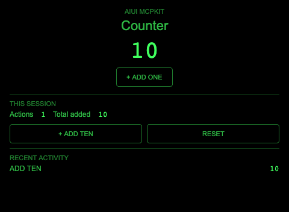
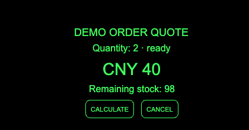

# AIUI MCPKit

**用 JavaScript 和 AIUI，构建可交互的 MCP Apps。**

为 AI 工具提供用户可以直接操作的界面：按钮、表单、业务计算和实时状态，都能呈现在 MCP Apps 客户端中。MCPKit 将你的 [AIUI 智能体](https://github.com/yodaos-project/AIUI)打包为插件，一并提供页面、[Ink](https://github.com/jsar-project/ink) WebAssembly 渲染器和 MCP 服务。

[](https://github.com/yodaos-project/aiui-mcpkit/actions/workflows/ci.yml)
[](https://github.com/yodaos-project/aiui-mcpkit/actions/workflows/benchmark.yml)
[](package.json)

[English](README.md) · [快速开始](#快速开始) · [示例效果](#看看实际效果) · [完整文档](docs/README.zh-CN.md) · [参与贡献](#参与贡献)

## 看看实际效果

| 可交互计数器 | 业务工具 |
| --- | --- |
| [](examples/counter) | [](examples/business) |
| 用工具参数打开页面，直接修改状态，并展开完整界面。 | 向模型返回报价，在界面展示库存，点击按钮调用或取消业务操作。 |

*截图来自本地 MCP Apps 浏览器测试宿主，使用真实 Ink/WASM 运行时。业务示例使用确定性的演示数据。*

## 为什么选择 MCPKit？

- **页面和工具共用一份定义。** 在 `.ink` 页面中声明名称、说明和 schema，自动生成工具注册、输入验证和业务类型，减少重复维护。
- **让模型调用当前界面中的方法。** 使用 `ModelContext.defineAction()` 声明 App/Page 工具，或在运行时动态注册；调用作用于当前实例，并支持取消和工具列表变化通知。
- **把界面操作接入 AI 对话。** 通过 `getApp().getAgent()` 发送用户消息、发布选中内容、调用宿主工具和读取资源，只发布你明确选择的状态。
- **用 TypeScript 编写业务工具。** 自动生成输入/输出类型，并在运行时校验；结构化结果提供给模型，UI-only 元数据用于界面，凭据保留在服务端代码中。
- **不打开界面，也能执行业务逻辑。** 使用 manifest 声明的 Agent Worker，通过真实 Ink 运行时执行；需要服务端集成时，也可继续使用 Node.js handler。
- **构建、交付与验证一起完成。** ESM API 生成服务、UI 资源、manifest 和类型声明，[预览验证](docs/guides/preview-verification.zh-CN.md)检查运行时、画面和业务就绪状态后才接受截图结果，内置进度、超时、取消、受控重试，并以真实 WASM 测试验证交互。

## 快速开始

准备 **Node.js 22+**、Git 和一个 MCP Apps 客户端。在终端执行：

```sh
git clone https://github.com/yodaos-project/aiui-mcpkit.git
cd aiui-mcpkit
npm ci
npm run build:examples
```

构建后，`dist/examples/` 下会生成两个独立插件：

| 示例 | 工具 | 可以体验什么 |
| --- | --- | --- |
| [Counter](examples/counter) | `open_counter`、`open_countdown` | 从 5 开始加一，或从 8 开始每次减 2。 |
| [业务示例](examples/business) | `quote_order`、`check_stock`、`find_products` | 通过 Worker Action 计算报价、查询库存和选择候选商品。 |

在 Codex Desktop 中体验时，使用支持插件命令的 Codex CLI 安装：

```sh
codex plugin marketplace add ./dist/examples
codex plugin add ink-counter@aiui-mcpkit-examples
codex plugin add business-demo@aiui-mcpkit-examples
```

重启宿主，确认工具出现在当前会话。让客户端以 `{ "initialCount": 5, "label": "Demo" }` 调用 `open_counter`，点击 **+ ADD ONE**，计数应从 **5 变为 6**。

业务示例还提供[多工具共享目录 App](docs/guides/shared-agent.zh-CN.md)：通过工具搜索、查看详情和选择商品，保留导航，并隔离每个 View 的状态。

Business Demo 通过 AgentWorker 的 `ModelContext.defineAction()` 实现工具。先在服务进程的 PATH 中配置 `ink-worker`，或设置 `INK_WORKER_BIN`（见[配置说明](docs/guides/business-tools.zh-CN.md)），再以 `{ "quantity": 2 }` 调用 `quote_order`，预期看到 **CNY 40**、剩余库存 **98**。宿主开启工具访问后，**CALCULATE** 和 **CANCEL** 可用于发起与取消业务调用。

Claude Desktop、VS Code 和直接 stdio 连接见[客户端接入](docs/guides/clients.zh-CN.md)。[完整示例教程](docs/getting-started/quickstart.zh-CN.md)介绍安装、工具发现和每一步的预期结果。

## 构建自己的智能体

按[创建第一个 Agent](docs/getting-started/first-agent.zh-CN.md)准备 `app.json` 和注册的 `.ink` 页面。在页面的 `script def` 中定义工具元数据与输入 schema，需要业务结果时再添加 `schema.output`，协议接入代码由 MCPKit 生成。

先运行 `npm run build`，再将下面内容保存为仓库根目录的 `build-agent.mjs`，智能体源码放在 `./agent/`：

```js
import { buildPlugin } from '@yodaos-pkg/aiui-mcpkit';

const plugin = await buildPlugin({
  source: './agent',
  name: 'my-agent',
  outputDir: './dist/my-agent',
});

console.log(plugin.outputDir);
```

执行 `node build-agent.mjs`，输出目录将包含 `view.html`、`dist/server.mjs` 和插件/连接 manifest。生成的服务已打包运行时依赖，部署宿主需要 Node.js 22+；原生 Worker 执行还需要 `ink-worker`。

在独立 Node.js 项目中接入，见 [ESM 包接入](docs/guides/esm-build.zh-CN.md)。业务执行使用 [AgentWorker Action](docs/guides/business-tools.zh-CN.md)；原生宿主契约见[运行时集成](docs/guides/runtime-integration.zh-CN.md#通过-worker-执行业务工具)。

## 让 AI 调用你的智能体

将下面的方法加入 Page 的默认导出对象，模型便可读取当前选择；绑定到 `askAssistant` 的按钮则可以显式发送用户消息：

```js
export default {
  data: { selectedSku: 'DEMO' },
  getSelection: ModelContext.defineAction({
    name: 'get_selection',
    description: '读取当前页面选中的商品',
    annotations: { readOnlyHint: true },
    execute() {
      return { selectedSku: this.data.selectedSku };
    },
  }),
  async askAssistant() {
    await getApp().getAgent().conversation.sendMessage({
      role: 'user',
      content: [{ type: 'text', text: '请介绍商品 ' + this.data.selectedSku + '。' }],
    });
  },
};
```

需要为后续模型轮次提供背景信息时，使用 `agent.provideContext()`；需要动态管理工具是否可用时，使用 `getApp().modelContext.registerTool()`。[Agent 会话与实时工具](docs/guides/agent-session.zh-CN.md)提供完整页面、上下文更新和工具撤销示例。

## 客户端支持

MCPKit 当前生成**本地 stdio 服务**。交互界面需要支持 WASM 的 MCP Apps 宿主；不支持 Apps 的客户端会收到工具数据和明确的界面不可用说明。

| 能力或客户端 | 当前验证情况 |
| --- | --- |
| Ink 渲染与 MCP Apps 通道 | 真实 WASM 浏览器测试覆盖工具输入/结果、界面操作、显示模式、消息、上下文与取消。 |
| Codex Desktop | 已观察到 Counter 内联界面；其他交互和显示模式由浏览器测试覆盖。 |
| Claude Desktop / VS Code | 已提供接入指南，针对本项目的实际界面验证仍待完成。 |
| 对话与实时工具 | 消息和上下文能力由宿主协商决定；宿主需将 View 工具路由给模型，真实模型消费情况需单独验证。 |

HTTPS 部署和对话卡片渲染仍是独立待办。协议版本与能力边界见[兼容性说明](docs/reference/compatibility.zh-CN.md)，固定的 Ink SDK 版本与 Worker 部署条件见[运行时集成](docs/guides/runtime-integration.zh-CN.md)。

## 文档导航

| 你想要…… | 从这里开始 |
| --- | --- |
| 理解 AIUI、Ink 与 MCPKit 的关系 | [认识 MCPKit](docs/getting-started/overview.zh-CN.md) |
| 创建页面并提供业务操作 | [页面工具](docs/guides/page-tools.zh-CN.md) · [业务工具](docs/guides/business-tools.zh-CN.md) |
| 发送消息、发布上下文或定义实时工具 | [Agent 会话](docs/guides/agent-session.zh-CN.md) |
| 无界面执行业务逻辑 | [运行时集成与 Worker](docs/guides/runtime-integration.zh-CN.md) |
| 接入构建流程或定制元数据 | [构建 API](docs/reference/build-api.zh-CN.md) · [元数据](docs/guides/metadata.zh-CN.md) |
| 更新安装或定位问题 | [开发迭代](docs/guides/development.zh-CN.md) · [故障排查](docs/guides/troubleshooting.zh-CN.md) |
| 测量渲染、打包和服务端开销 | [性能基准](docs/reference/benchmarks.zh-CN.md) |

[查看全部指南与参考 →](docs/README.zh-CN.md)

## 参与贡献

欢迎提交客户端测试记录、可运行示例、文档改进和运行时修复。[提交 Issue](https://github.com/yodaos-project/aiui-mcpkit/issues) 时，请附上客户端版本和复现步骤，也欢迎范围清晰的 Pull Request。

```sh
npm run build:examples
npx playwright install chromium
npm run typecheck
npm test
```

原生 Worker 测试与基准检查步骤见[贡献指南](docs/contributing.zh-CN.md)。基准会记录方法和测量边界，与功能测试共同验证项目质量。

基于 [AIUI](https://github.com/yodaos-project/AIUI)、[Ink](https://github.com/jsar-project/ink) 和 [MCP Apps SDK](https://github.com/modelcontextprotocol/ext-apps) 构建。
