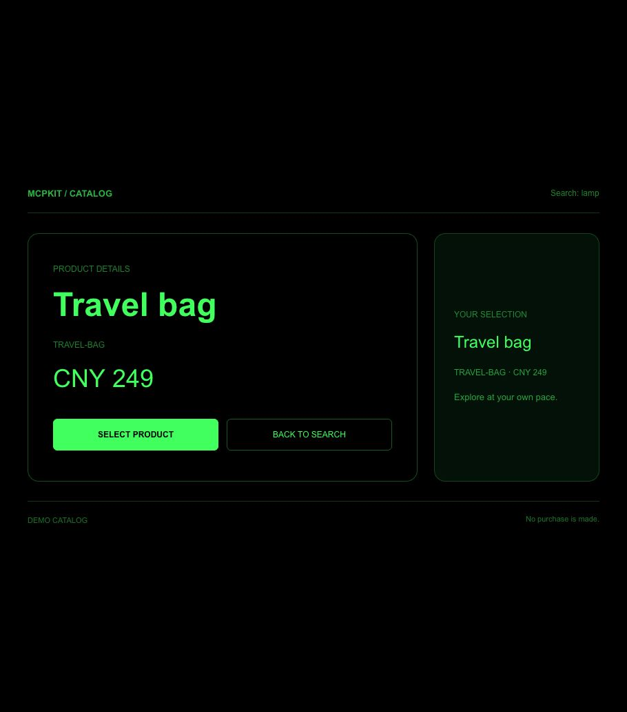

# Multiple tools in one App

English | [简体中文](shared-agent.zh-CN.md) · [Documentation index](../README.md)

Business Demo includes a shared catalog with search, product details and selection. Worker actions query and validate demo products; App actions update the original live UI. No purchase is made and no example-specific MCP server is needed.



## Register the UI independently

```js
await buildPlugin({
  source: 'examples/business', name: 'business-demo',
  worker: { name: 'business' },
  applications: { catalog: { page: 'pages/catalog/index' } },
});
```

A page's JSON `script def` may contain a nonempty `tools` array instead of a single `schema`. Each entry has its own `tool`, `description` and `schema.data`/`schema.output`. Set `application: "catalog"` on the definition or individual entries to bind them to that registered App. The registry page must exist in `app.json.pages`. Contract declarations can live on another registered page; they do not determine the shared UI route.

`search_catalog`, `inspect_catalog_product` and `select_catalog_product` share `ui://business-demo/applications/catalog.html`. Only one resource is registered. Each contract is validated separately and Worker actions use the same names. See the complete [declarations](../../examples/business/pages/catalog/index.ink) and [Worker](../../examples/business/workers/business.js).

## Update the original App

Build and update the installed Business Demo from the repository root:

```sh
npm run build:examples
node scripts/update-examples.mjs --example business
```

Reload the MCP server/desktop host and open a fresh View. Call `search_catalog({"query":"travel"})` to open a catalog, then use its **live App tools**:

| Tool | Effect |
| --- | --- |
| `catalog_search({query})` | Updates search results without leaving the detail page or clearing selection |
| `catalog_inspect({sku})` | Opens product details in the same App; keeps search and selection |
| `catalog_select({sku})` | Changes selection without navigating or buying |
| `catalog_state({})` | Reads that instance's identifier, route, search, detail, selection and revision |

These are `ModelContext.defineAction()` methods in [app.js](../../examples/business/app.js). They call the Worker-backed server tools using `getAgent().callTool()` and apply results to their owning App. The host must route View-provided tools to the model and select the intended View when multiple catalogs are open. They are not server discovery tools. Do not call another server entry point to target a previous card: the host may create a separate View.

When the host sends a subsequent input/result to an existing shared View, MCPKit delivers the result with `tool` and `input` fields and preserves the bundle, navigation stack and App actions. Ordinary page tools retain their existing relaunch behavior. Shared Views ignore results for other application routes. Host result notifications have no invocation ID: overlapping host notifications with identical arguments cannot be correlated reliably. Use live App actions for concurrent updates; the example ignores stale search completions.

When a host exposes browser WebMCP, the View also projects its live Ink registry into `document.modelContext` (or the legacy navigator registry). A browser agent can discover and call these same instance-bound Actions through WebMCP. Registrations follow tool changes and teardown; unchanged App tools survive Page navigation. Hosts without this browser API keep the MCP Apps route. Neither route duplicates Worker/business implementations.

The catalog has a dedicated `_blank` layout: a centered workspace with larger product details and a separate selection summary. Narrow viewports stack the panels and actions, while short viewports use compact controls. The inline card keeps a compact product grid. Switching display mode or resizing preserves App state.

## Ownership and isolation

Each View owns one App realm. The App holds navigation-related state, search results, inspected product and selection. Pages attach to it on show, detach on hide/unload, and refresh when returning from detail. Shared state is never stored in a module singleton, browser storage or the headless Worker. Worker methods return data without persisting a user's selection.

New cards, Views, users and conversations do not join an existing instance automatically. Even if they use the same resource URI or server process, their UI state is independent. Closing a View destroys its App and cancels its live calls. By default this is in-memory persistence for the lifetime of a View. For reconstruction in a supporting host, the catalog implements the opt-in [scoped snapshot protocol](state-restoration.md), including a private draft. It requires a trusted store adapter; it does not provide account authentication or assume desktop host persistence.

## Acceptance

`tests/shared-agent-browser.test.mjs` runs the real stdio server, Ink WASM, two simultaneous Views and another browser page. It verifies resource deduplication, independent contracts, search/detail/selection, preservation after new tool data, back navigation, stale results, failed selection, teardown and state isolation. `tests/metadata.test.mjs` checks bindings to a different UI page and invalid registrations.

For target-client acceptance, record the client version, SDK and actual calls. Search travel, inspect the bag, select it, search lamp while remaining on detail, and read state. The instance ID must stay the same, detail and selection must remain the bag, and search must become lamp. Return to search, open a second catalog and confirm it has no selection. Browser bridge tests do not prove that the desktop host routes live tools to its model. See the [validation record](../validation/shared-agent-2026-10-28.md).
