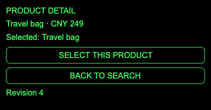
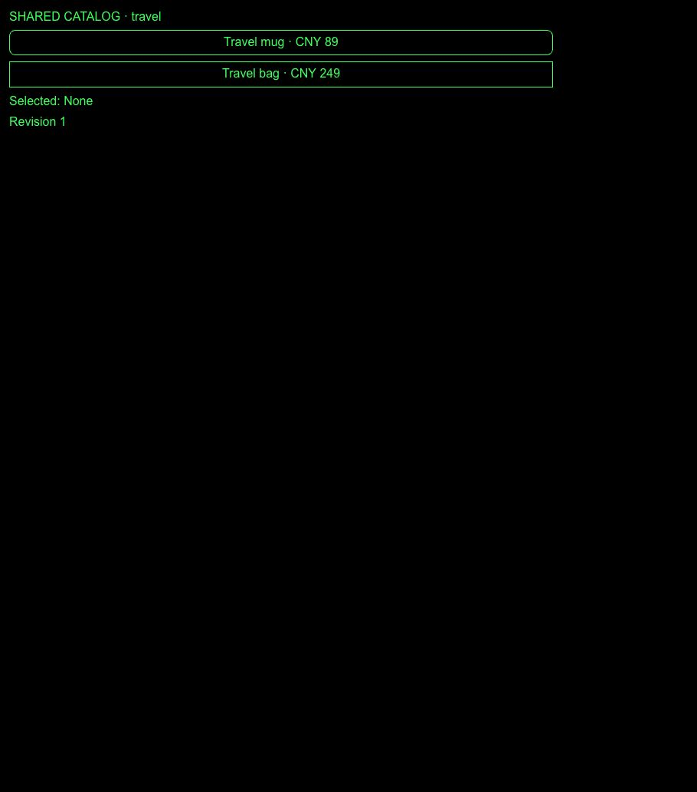

# Shared Agent validation — 2026-10-28

Status: implementation, local protocol/browser tests and real desktop model calls passed. Issue #6 remains open until the implementation is merged.

## Environment

- Working branch: `codex/issue-6-shared-agent`.
- Node: `v25.2.1`.
- Ink SDK: `0.20.0-daily.20261027171530`.
- MCP client/server/core SDK: `2.2.0`; MCP Apps: `2.0.3`.
- Worker execution: `scripts/ink-worker-wasm.mjs`, using the published Ink runtime.
- Browser: installed Google Chrome, automated through Playwright.
- Installed desktop bundle checked during live verification: `ChatGPT.app` version `26.1023.50603`, build `22391` (read from its Info.plist).

## Completed checks

```sh
npm run build:examples
npm run typecheck
INK_WORKER_BIN="$PWD/scripts/ink-worker-wasm.mjs" \
CHROMIUM_PATH='/Applications/Google Chrome.app/Contents/MacOS/Google Chrome' \
npm test
```

Initial result: **72 passed, 0 failed, 0 skipped**. After adding the browser WebMCP projection and lifecycle coverage, the final full suite passed **75 tests, 0 failed, 0 skipped**; build and typecheck also passed. The shared-App test additionally covers initial tool-list notifications, rejection of unrelated application results, browser-facing Action execution and registration cleanup.

The real stdio server advertises three independent contracts referencing one catalog resource. Real Ink WASM exposes four App actions through MCP Apps View tool listing/calling. These calls execute within the owning App; the browser host forwards queries to the actual generated server and Ink Worker.

Observed sequence:

1. Search `travel`: mug and bag appear.
2. Inspect and select `TRAVEL-BAG`: detail and selection both refer to the bag.
3. Deliver a new server search result for `desk` to the same View: instance ID, detail route and bag selection remain; results become the lamp.
4. An unrelated application route's result is ignored.
5. Start a delayed `travel` search, complete `lamp`, then release the older search: the query remains `lamp`.
6. Select an unknown SKU: the operation fails and the bag stays selected.
7. Click back: the original search page displays the lamp and preserves the bag selection.
8. The second simultaneous View remains unchanged throughout. Destroying the first leaves the second usable. A fresh browser page has a different instance ID, search route and no selection, even though it uses the same server.

Screenshots are actual Ink/WASM output, captured from the browser harness:




## Desktop/model acceptance history

The installed Business Demo artifacts were updated with `node scripts/update-examples.mjs --example business`; its Worker environment configuration was preserved. The initial chat exposed only `quote_order`, `check_stock` and `find_products`. After the user disabled/re-enabled the plugin, this same chat discovered all six server tools without restarting the desktop application.

The real desktop model called `search_catalog({"query":"travel"})` successfully. The result contained Travel mug (`TRAVEL-MUG`, CNY 89) and Travel bag (`TRAVEL-BAG`, CNY 249). The user confirmed that the SHARED CATALOG UI rendered both products. After that confirmation, another inventory check still did not expose the four live `catalog_*` App tools to this model. This proves server discovery, execution and user-observed rendering, not a live App mutation.

A supported browser/MCP-App inspection route was investigated using the bundled `control-in-app-browser` skill. Its connection attempt was blocked by the host with `Local browser use is disabled in Work settings`. No native UI automation or substitute model acceptance was performed. The available evidence does not establish whether View tools are absent in the host or simply unavailable through this chat's current tool surface.

## Final real desktop/model result: passed

After the desktop restart, the supported `mcpapps` browser surface became available through the unified computer-use tool. The user expanded the catalog into the side panel. The original View exposed no WebMCP tools even though its UI rendered correctly. A focused real Ink test confirmed that initial MCP Apps tool-list notifications were delivered; a missing initial notification was not the cause.

The runtime now optionally projects the Ink registry into the browser WebMCP registry. Modern `document.modelContext` is preferred; legacy navigator registration/unregistration is supported when supplied by the desktop host. The existing MCP Apps View protocol remains available. Definitions, execution and state still belong to the original Ink App/Action; no business logic or example server was duplicated. Standard registration/lifecycle semantics are documented in [Google's primary WebMCP guide](https://github.com/GoogleChrome/modern-web-guidance/blob/main/skills/modern-web-guidance/guides/webmcp/agentic-javascript-tools.md).

After updating the installed artifacts, the real model called `search_catalog({"query":"travel"})` again, and the user expanded that new card. The desktop browser tool discovered and invoked the four document-bound `catalog_*` tools. This was actual model-selected WebMCP execution against the displayed App, not a standalone Playwright or simulated model test. The plain server MCP inventory did not automatically acquire these View tool names.

Observed values from the real calls:

| Call | Instance | Query | Route | Detail | Selected | Revision |
| --- | --- | --- | --- | --- | --- | --- |
| `catalog_state({})` | `catalog-xxy9hi4tgne` | travel | search | null | null | 1 |
| `catalog_inspect({sku:"TRAVEL-BAG"})` | `catalog-xxy9hi4tgne` | travel | search during async navigation | TRAVEL-BAG | null | 2 |
| `catalog_select({sku:"TRAVEL-BAG"})` | `catalog-xxy9hi4tgne` | travel | detail | TRAVEL-BAG | TRAVEL-BAG | 3 |
| `catalog_search({query:"lamp"})` | `catalog-xxy9hi4tgne` | lamp | detail | TRAVEL-BAG | TRAVEL-BAG | 4 |
| final `catalog_state({})` | `catalog-xxy9hi4tgne` | lamp | detail | TRAVEL-BAG | TRAVEL-BAG | 4 |

The final search contained only Desk lamp (`DESK-LAMP`, CNY 159); detail and selection remained Travel bag (`TRAVEL-BAG`, CNY 249). Navigation is asynchronous: the immediate inspect return preceded Page `onShow`; subsequent state calls and the screenshot confirmed the completed detail navigation.

The other simultaneous catalog stayed on `travel`, revision 1, with both original candidates and `Selected: None`. Its screenshot supplies real desktop isolation evidence. This earlier card used the pre-WebMCP template, so its instance ID was not read through WebMCP. Exact distinct-ID isolation, teardown and fresh-conversation state were additionally checked by the local real Ink browser test. Separate authenticated user accounts were not exercised; the UI runtime stores state only in each independent App realm and does not implement account authentication or shared persistent storage.

The user manually expanded cards. The model performed the business operations through document-bound tools. Native Codex window automation was rejected by the computer-use tool, so no native button automation was used. Desktop screenshots capture the full visible App document; the backend does not support cropped captures.




No purchase was made. No issue was closed and no GitHub changes were published during this acceptance step.
