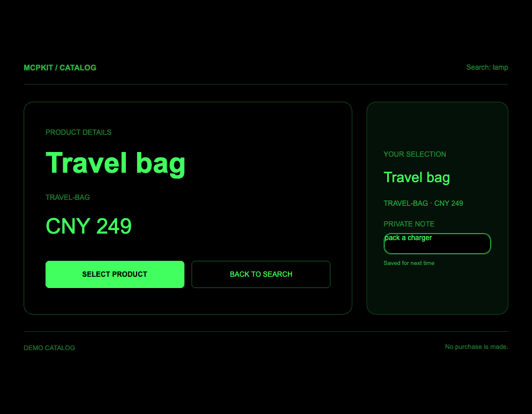

# Scoped state restoration validation

Issue: [#8](https://github.com/yodaos-project/aiui-mcpkit/issues/8). Working branch: `codex/issue-8-scoped-state`, based on main including merged PRs #26, #27 and #28.

Local implementation acceptance passed in the application-owned MCP Apps test host. This record does not claim that Codex Desktop supplies persistent storage. The standard examples have no restoration adapter; the integration under test explicitly supplies one.

## Environment and commands

- Node `v25.2.1`; Google Chrome `156.0.8078.73`, headless Playwright.
- Ink `0.20.0-daily.20261027171530`, real QuickJS/WASM UI and Worker runtime.
- MCP client/server/core `2.2.0`; MCP Apps `2.0.3`.
- Host at `127.0.0.1`, View at `localhost`, with distinct origins. A trusted parent owns the store and assigns simulated user/chat/instance identities from iframe ownership. The View receives a bound MessagePort capability.

```sh
npm run build:examples
npm run typecheck
INK_WORKER_BIN="$PWD/scripts/ink-worker-wasm.mjs" \
CHROMIUM_PATH='/Applications/Google Chrome.app/Contents/MacOS/Google Chrome' \
npm test

INK_WORKER_BIN="$PWD/scripts/ink-worker-wasm.mjs" \
CHROMIUM_PATH='/Applications/Google Chrome.app/Contents/MacOS/Google Chrome' \
npm run bench -- --samples 1 --operations 3 --idle-ms 250 \
  --server-calls 8 --out benchmark-results/ci
```

Build and type checks passed. Full suite: **95 passed, 0 failed, 0 skipped**. Benchmark correctness smoke passed all four WASM scenarios and server workloads; this is not a performance threshold claim or a remote CI result.

## Reconstruction sequence

The [browser test](../../tests/state-browser.test.mjs) builds the Business Demo with the explicit adapter, starts its generated stdio server and executes real Ink Worker business actions:

1. Search `travel`; inspect and select `TRAVEL-BAG` using live App tools.
2. Type `pack a charger` into the actual Ink input. Hold the first writes to verify that an older acknowledgment cannot mark a newer pending edit as saved, then await checkpoints while finishing the note. The checkpoint is the durability boundary.
3. Switch inline → fullscreen. Public state and tool results remain unchanged.
4. Tear down the View and destroy its realm. Create another View with the same trusted scope and a fresh initial `lamp` search.
5. The App instance identifier, bag selection, detail product, private note and detail page are restored. New tool data updates the query/results to `lamp`/`DESK-LAMP` after restoration.
6. Click Back in the reconstructed detail page. The App returns to search and checkpoints that route while preserving its selection and private note.
7. Open Views for another user, another conversation and another instance. Each starts on search without selection or draft and has a distinct App identifier. A different application binding is rejected with `SCOPE_MISMATCH` and creates no record.
8. Send a forged scope in a binding request from the App. The trusted host still binds that iframe to its original user/instance.
9. Disable the provider and rebuild a View. Its normal tools remain usable, `data-restoration` is `unavailable`, and it does not alter the existing snapshot.
10. Confirm no draft appears in public `catalog_state` results, model-context updates, user messages or runtime logs.

Actual rebuilt Ink/WASM output from this test host, with the bag/detail/note restored and the fresh `lamp` query applied:



## Storage and version checks

[State tests](../../tests/state.test.mjs) verify all four scope dimensions, immutable capabilities, detached copies, collision-safe keys, foreign-envelope rejection, serialized writes, teardown flushing, stale concurrent View conflicts, strict JSON/size/route/schema validation, older-version migration, unsupported future/unknown versions, corrupt snapshots, failed migrations, redacted errors and aborted timeout signals. Failed restoration does not overwrite an existing record. Type tests cover readonly scope, fixed-capability methods and non-JSON payload rejection.

The memory factory is held by the trusted parent and lives beyond child Views. It provides no durability after parent/process restart and no production identity provider. An authenticated durable backend can replace it through `ScopedSnapshotStore`; atomic revision checks and abort-before-commit behavior remain backend obligations.

## Remaining target-host integration

The [restoration guide](../guides/state-restoration.md) defines the adapter, authorization boundary, message handshake, version policy and unsupported cases in English and Chinese. No universal Codex/Claude persistence API is assumed. Production acceptance must supply authenticated scope assignment and a persistent backend, verify reconstruction in that target host, and test restart recovery if promised. Sudden exit can lose the last unacknowledged edit; checkpoint acknowledgment, not an unload callback, defines successful persistence.
